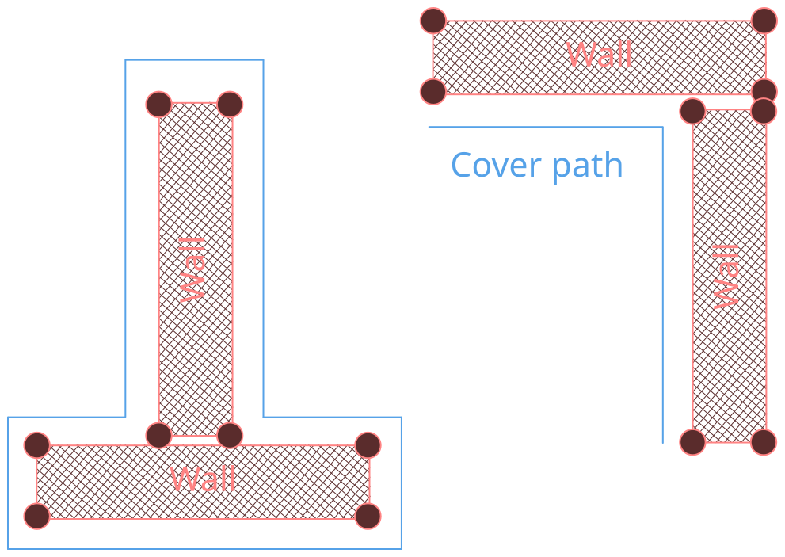

# Cover System

> Turns separate wall modules into one continuous cover path the player character walks along.

The game world is built from wall modules. Placed next to each other, they form corners, T-junctions and rooms.
Instead of treating every wall on its own, the cover system merges touching walls into one group and generates a
single path around it.

The player character is locked onto this path. Moving along it, the player can peek around corners to spot enemies
without leaving cover.

___
## 1. `ACoverObject` and Footprint

The cover system works on `ACoverObject`, an actor derived from `AActor`. It owns a `UStaticMeshComponent` as its root, and the bounds of the assigned static mesh are the only thing the system reads from it. From these bounds, the object computes its **footprint**: four corners on the ground, rotated and scaled with the actor (an oriented bounding box, not an axis-aligned one).

![[cover-footprint.svg|1400]]

When an `ACoverObject` is constructed, `OnConstruction` calls `BuildPerimeter()`, which in turn calls `GetFootprintCorners()`. The footprint is the foundation for everything that follows: the spatial grid, the grouping and the cover paths are all built from it.

### How `GetFootprintCorners` works

1. **Read the bounds in mesh space.** `Mesh->GetBounds()` returns the unrotated box of the mesh as `Origin` and
   `BoxExtent`.
2. **Derive the ground rectangle.** `HalfX` and `HalfY` are the extents on X and Y times `ExtentScale`. The corners lie
   on the bottom of the box, at `BottomZ = Origin.Z - BoxExtent.Z`.
3. **Build the four corners** at `Origin ± (HalfX, HalfY)`, always in the same order.
4. **Transform them into world space** with the component transform. Rotation, scale and position of the actor move
   all four corners, so the result is an oriented box instead of an axis-aligned one.

The function returns `false` if no static mesh is assigned. The mesh needs no collision, because the bounds come from
the mesh itself and not from the physics shapes.

## 2. Registry and spatial grid

## A. TODO

### Next
- [ ] Housekeeping: default `OutlineSimplifyTolerance` 15 cm, `[[nodiscard]]` on `FCoverSpatialGrid::Insert`, `!CoverObject` check in `UnregisterCoverObject`, remaining `LogTemp` to `LogCover`, remove the temporary footprint log, `DrawSides` uses `GetFootprintEdges`, check that PIE ends without warnings
- [ ] Rebuild only the affected groups (measure first with debug drawing switched off)

### Later
- [ ] Player interaction (walk along the outline, switch sides, cover mode, animation)

## B. Parked, only if it hurts
- [ ] Editor view of the whole outline (the side component is the template for it)
- [ ] `SetStaticMesh` at runtime: footprint changes without a transform event, the grid and the side drawing keep the old state
- [ ] Remove `PerimeterSpline`, `PerimeterHeight` and `PerimeterScale`
- [ ] Doxygen for the new classes, documentation sections 3 to 5
- [ ] Outer loops vs. holes, custom footprint spline, preview actors, gap at opposite edges
- [ ] Automation tests, outline cache, cover as a component