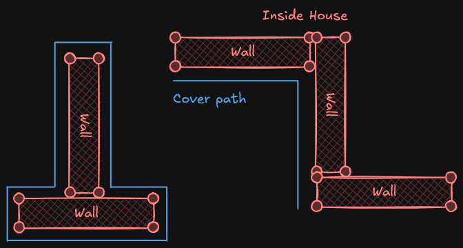

---
type: system
status: in-progress
category: gameplay
topics: [cover]
tags: [emberfall]
author: matthias stefan
date-added: 2026-11-02
date-completed:
---

# Cover System

> Turns separate wall modules into one continuous cover path the player character walks along.

The game world is built from wall modules. Placed next to each other, they form corners, T-junctions and rooms.
Instead of treating every wall on its own, the cover system merges touching walls into one group and generates a
single path around it.

The player character is locked onto this path. Moving along it, the player can peek around corners to spot enemies
without leaving cover.

___

## Open

### Outline
- [ ] Chain the kept pieces into ordered, closed loops (tolerance on end points)
- [ ] Simplify loops (Ramer-Douglas-Peucker) and drop tiny loops, needs `OutlineSimplifyTolerance` and `OutlineMinLoopArea`
- [ ] Store the loops in `FCoverGroup`
- [ ] Move the loop building (`BuildLoops`) from `DrawDebug` into `FCoverOutlineBuilder`
- [ ] Tell outer loops from holes (courtyards), e.g. by winding
- [ ] Decide: closed loop around the group, or path on one side only (see overview picture)
- [ ] `ensure` that `OutlineOffset >= MergeRadius / 2`
- [ ] Known gap: two shapes that only touch with opposite edges keep an edge in their interior

### Cover system
- [ ] Self-registration in `ACoverObject` (`BeginPlay` / `EndPlay`)
- [ ] Dirty flag for groups, rebuild once per frame instead of only at world start
- [ ] First unit that uses the outline (nearest point, walk along, lock onto the path)
- [ ] Replace or remove the per-object `PerimeterSpline`
- [ ] Optional: cache outlines by member set (mage wall)

### Cleanup
- [ ] Doxygen for the new geometry functions, `FCoverEdgePiece` and `FCoverOutlineBuilder`
- [ ] `Num() < 3` guard in `ContainsPoint2D`
- [ ] Automation tests for `FCoverGeometry` and `FDisjointSet` (paper examples)
- [ ] Note the simplification: height is ignored, all cover stands on one level

